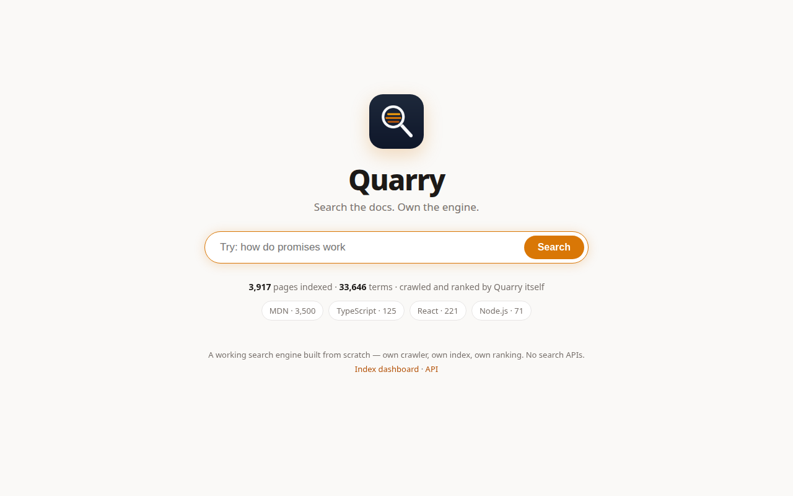
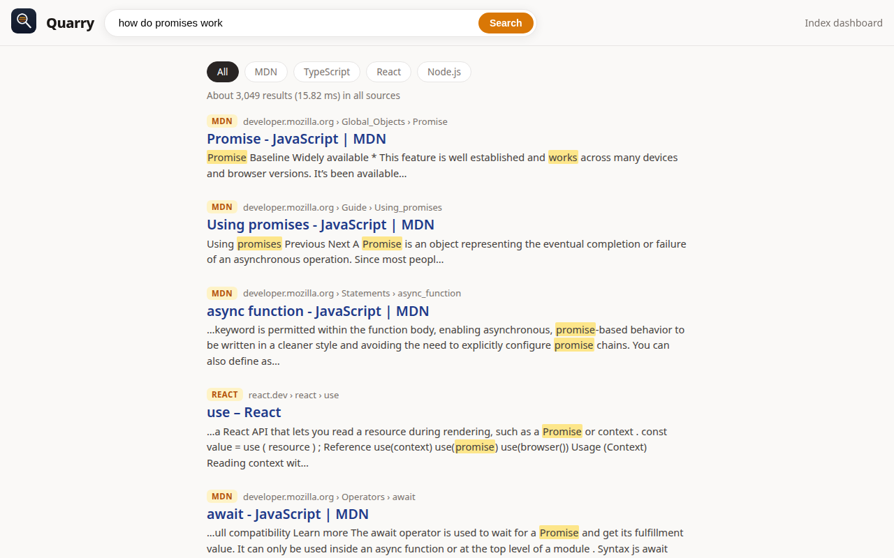
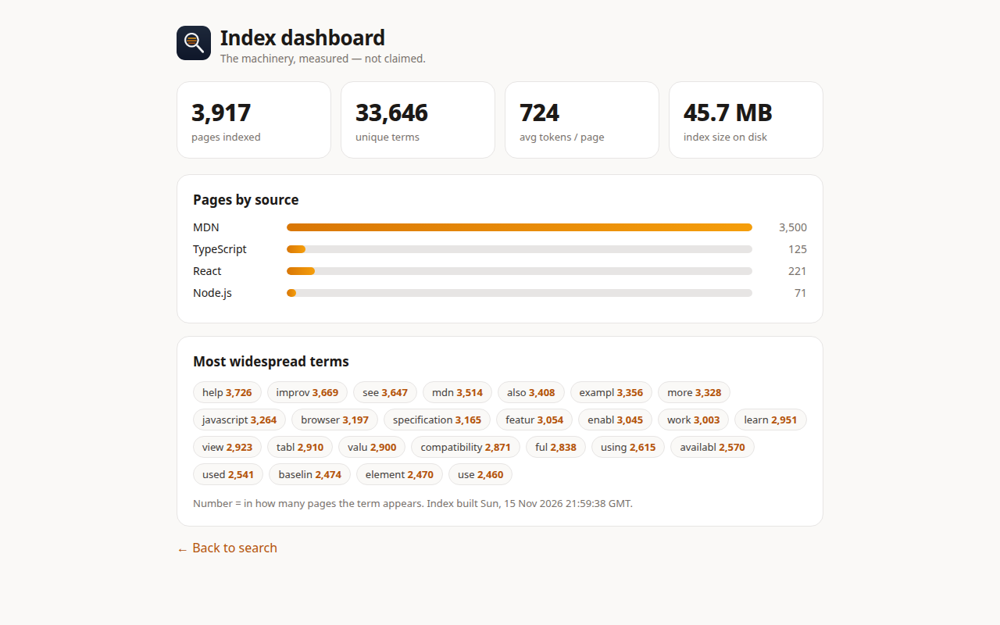
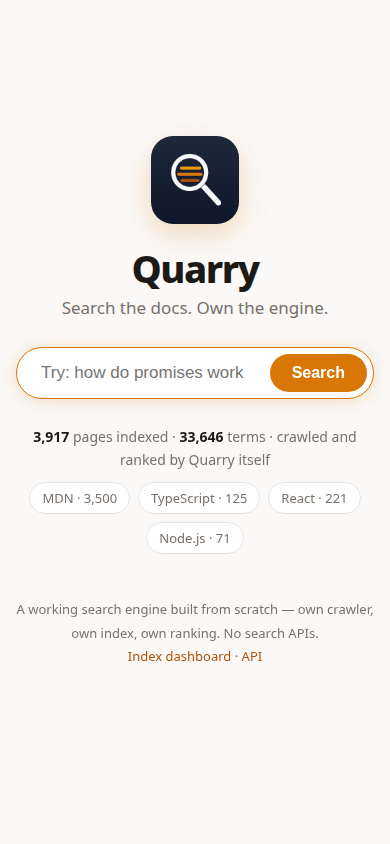
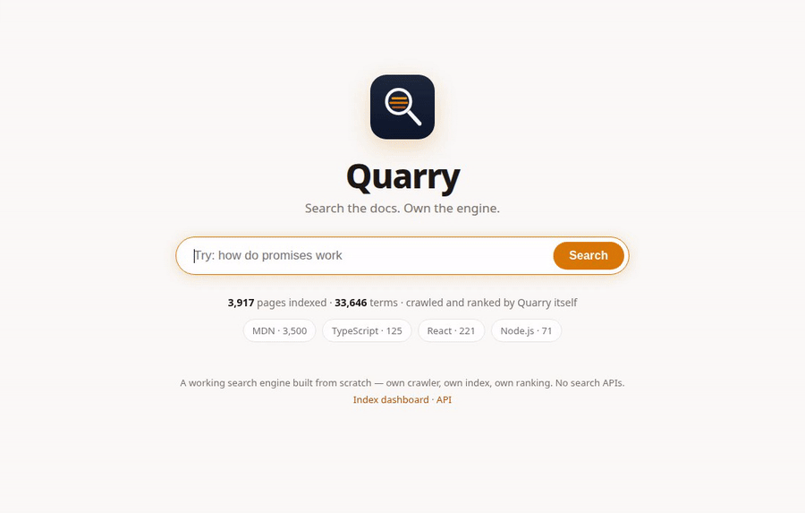

<p align="center">
  
</p>

<h1 align="center">Quarry</h1>

<p align="center"><b>Search the docs. Own the engine.</b></p>

<p align="center">
  A working search engine for developer documentation — own crawler, own inverted
  index, own BM25 ranking. Built from scratch in TypeScript with
  <b>zero dependencies</b>. No search APIs, no borrowed results.
</p>

<p align="center">
  
  
  
</p>

## Screenshots

| Home | Search results |
| --- | --- |
|  |  |

| Index dashboard | On a phone |
| --- | --- |
|  |  |

**Demo:**  · [Watch the MP4](docs/demo.mp4)

## What it is

Quarry is the Google architecture — **crawl → index → rank → results page** —
scoped to one territory instead of the whole web: developer documentation.
You type a question, and Quarry answers from its own index of pages its own
crawler fetched. If a page was never crawled, it can never appear; every
score it returns can be traced back to the ranking formula.

The reference crawl run for this README indexed **3,917 pages** (MDN 3,500 ·
React 221 · TypeScript 125 · Node.js 71) into a 45.7 MB index holding
33,646 unique terms. Searching *"how do promises work"* returns 3,049
candidate results in about 5 ms, topped by MDN's Promise reference page —
every score produced by the BM25 implementation in `src/engine.ts`.

## Features

- **Own crawler** — breadth-first, deduplicating, boilerplate-aware;
  respects every site's `robots.txt` and enforces per-host politeness delays
- **Own inverted index** — every term mapped to its pages and positions,
  with field weighting (title ×3, headings ×2, body ×1)
- **BM25 ranking** — rarity-weighted, length-normalised scoring; the same
  family of algorithm real engines are built on
- **Snippets** — cut around the first match, query terms highlighted
- **Search page + results UI** — source filters (MDN / Node.js / TypeScript /
  React), result counts and query timings, responsive down to phone widths
- **Index dashboard** — the machinery measured, not claimed: pages per
  source, vocabulary size, most widespread terms
- **JSON API** — `GET /api/search?q=...` and `GET /api/stats`; the web UI is
  just one client of the engine
- **Zero dependencies** — the whole product is TypeScript on Node's standard
  library; there is nothing to `npm install`

## Quickstart

Requires Node.js 22 or newer. There are no packages to install.

```bash
git clone https://github.com/Abhisheklang/quarry.git
cd quarry

node src/crawl.ts        # crawl the corpus into data/pages.jsonl (resumable)
node src/build-index.ts  # build data/index.json
node src/server.ts       # serve on http://localhost:3000
```

Then open <http://localhost:3000>, or query the API:

```bash
curl "http://localhost:3000/api/search?q=how+do+promises+work"
```

## The corpus

A deliberately fenced allowlist — deep on one territory instead of thin on
everything. The crawler never leaves these prefixes:

| Source | Scope | Cap |
| --- | --- | --- |
| MDN Web Docs | `developer.mozilla.org/en-US/docs/Web` | 3,500 pages |
| Node.js | `nodejs.org/api/` | 200 pages |
| TypeScript | `typescriptlang.org/docs/` | 700 pages |
| React | `react.dev/` | 500 pages |

Re-running `node src/crawl.ts` resumes: pages already stored are not stored
twice. The index data (`data/`) is generated and intentionally not committed;
the screenshots above are from a reference crawl run with exactly these
settings.

## How it works

1. **Crawl.** Starting from seed pages, the crawler fetches a page, extracts
   its main text, and follows links inside the allowlist — checking
   `robots.txt` first and pausing between requests to each host.
2. **Index.** Each page is tokenised and stemmed, and an inverted index is
   built: for every term, the list of pages containing it and the exact
   positions. Document lengths and term rarity are recorded for ranking.
3. **Rank.** A query is tokenised the same way; candidate pages are scored
   with BM25 (term frequency saturated and normalised by document length,
   weighted by inverse document frequency), with title and heading matches
   boosted by the field weighting baked into the index.
4. **Present.** The top results get snippets cut around the first match,
   terms highlighted, and the whole thing is served by one dependency-free
   Node server that renders the pages itself.

See [docs/ARCHITECTURE.md](docs/ARCHITECTURE.md) for the index format, the
ranking parameters, and the honest limitations.

## Project structure

```
src/
  text.ts         tokeniser, stemmer, HTML extraction
  crawler.ts      robots-aware crawler (per-host politeness + concurrency)
  crawl.ts        crawl CLI with the frozen source list
  engine.ts       inverted index, BM25 search, snippets, stats
  build-index.ts  index build CLI
  server.ts       web service: search UI, results, API, dashboard
test/             node:test suites for text, robots and ranking
assets/           logo (SVG + PNG) and its generator script
docs/             architecture notes, screenshots, demo recording
```

## Tests

```bash
npm test   # node --test — 14 tests, no framework, no install
```

## Roadmap

- Full Porter stemmer (v1 uses a light suffix stemmer)
- Phrase queries using the stored positions
- Segment-based index format (v1 persists one JSON file)
- Incremental re-crawling on a schedule

## Licence

MIT — see [LICENSE](LICENSE). Quarry is 100% original code; the licence
carries only its own copyright. The documentation pages it crawls and
indexes belong to their respective owners and are never redistributed —
Quarry indexes them, exactly as any search engine does.
